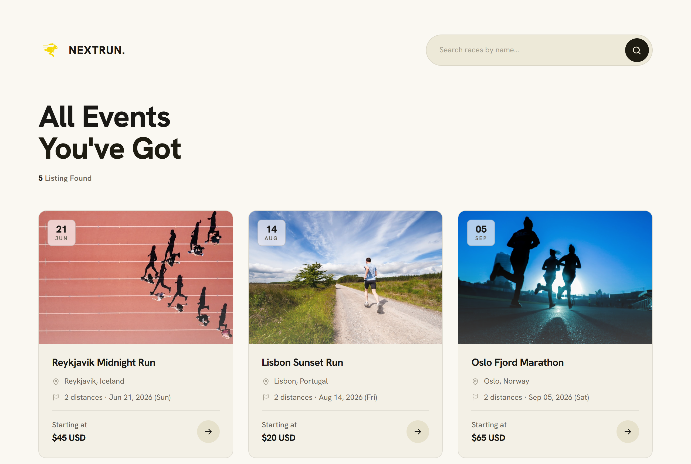
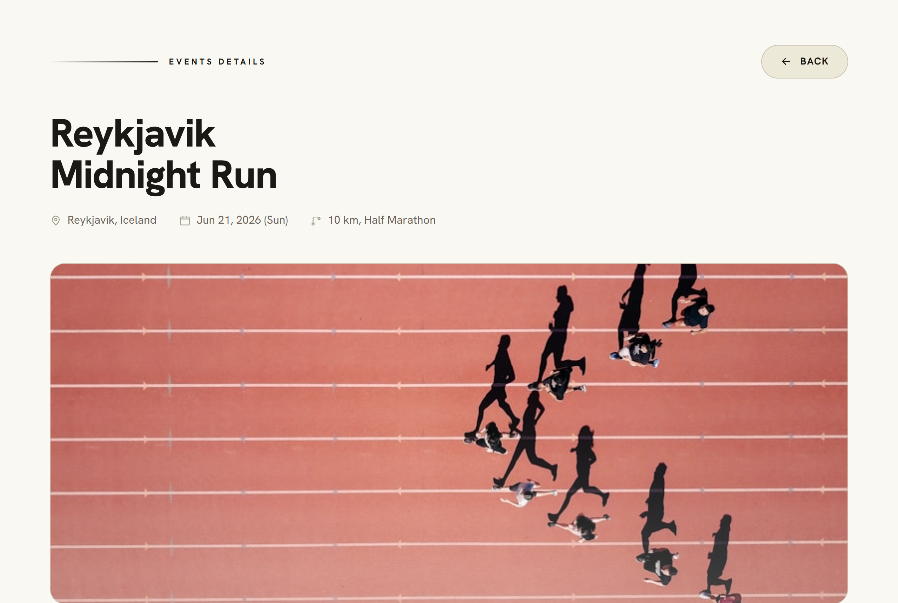
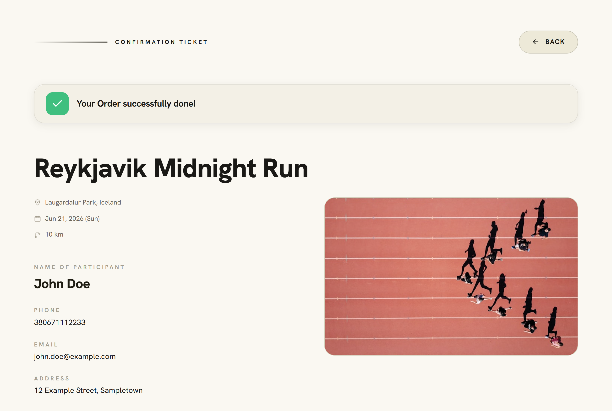

# NEXTRUN — a spec-driven, AI-assisted build

A single-page app for browsing running races and registering for them
(browse → details → checkout → downloadable PDF ticket), built **end-to-end
through a documented AI workflow** with Claude Code — and reproducible by
another developer from the docs alone.

**Live demo:** https://vestanra.github.io/
&nbsp;·&nbsp; **Stack:** React 19 · TypeScript · Vite 8 · React Router · React Hook Form · jsPDF · MockAPI



<table>
  <tr>
    <td width="50%"></td>
    <td width="50%"></td>
  </tr>
  <tr>
    <td align="center"><em>Event details → pick a distance</em></td>
    <td align="center"><em>Confirmation → downloadable PDF ticket</em></td>
  </tr>
</table>

---

## Why this repo is interesting

Most portfolio projects show *an app*. This one shows *a repeatable engineering
process* for building software with an AI agent, where a written specification
drives the AI rather than the other way around:

| Artifact | Role |
|---|---|
| [SPEC.md](SPEC.md) | **What** we build and why — the single source of truth for behavior. |
| [INSTRUCTIONS.md](INSTRUCTIONS.md) | **How** — the app built as a sequence of prompt blocks (`Context → Goal → Build → Acceptance → Verify`), each traceable back to a SPEC section. |
| [ACCEPTANCE.md](ACCEPTANCE.md) | **Proof** — an acceptance checklist verified against the running app, step by step. |
| [design_handoff_nextrun/](design_handoff_nextrun/) | **Design source of truth** — a runnable HTML/React prototype + design tokens, used instead of Figma. |
| `src/` | The resulting production app. |

The point: an AI agent is only as good as the constraints you give it. Here the
spec, design tokens, and acceptance criteria keep the agent honest and make the
whole build **reproducible** — start from an empty directory with only the docs
bundle and regenerate the same app (see *Rebuild from scratch* below).

## Engineering highlights

- **Typed API boundary** with runtime validation — malformed records from the
  fake backend are filtered out rather than trusted ([src/lib/api.ts](src/lib/api.ts)).
- **Client-side PDF ticket** drawn imperatively with jsPDF, no server
  ([src/lib/generateTicketPdf.ts](src/lib/generateTicketPdf.ts)).
- **Deep-linkable multi-step flow** with React Router; CSS Modules + design
  tokens for styling, zero UI framework.
- **Deployed via GitHub Actions** to GitHub Pages on every push to `main`.

---

## Run it locally

**Prerequisites:** Node.js 20.11+ (Vite config uses `import.meta.dirname`).

```bash
npm install
npm run dev            # http://localhost:5173 — works out of the box
```

No configuration needed: `npm run dev` runs against bundled static demo data.
To develop against a real MockAPI backend instead, see [`.env.example`](.env.example).

### Quality checks

```bash
npm run build      # production build (must exit 0)
npx tsc --noEmit   # type check
npm run lint       # ESLint
```

### Verify against acceptance criteria

Open [ACCEPTANCE.md](ACCEPTANCE.md) and start at **§0 Pre-flight** — tick each
box after observing the outcome in the running app.

---

## Rebuild from scratch (the reproducible part)

Want to rebuild the app yourself from the docs, the way a mentor would — without
the finished `src/` spoiling it? Use the **docs-only starter kit**:

1. Download **[`nextrun-starter.zip`](../../releases/latest)** (GitHub Releases) —
   it contains just `SPEC.md`, `INSTRUCTIONS.md`, `ACCEPTANCE.md`,
   `design_handoff_nextrun/`, and `.env.example`. **No source code, no secrets.**
2. Unzip into an empty directory and open `design_handoff_nextrun/Events Listing.html`
   to explore the target design (it replaces Figma as the visual source of truth).
3. Open Claude Code in that directory and paste:

   > Read INSTRUCTIONS.md. Execute Step 1. After finishing each step, list what I
   > should verify and wait for my confirmation before moving to the next step.

4. Claude works through Steps 1 → 11 sequentially, pausing for sign-off after each.

**Backend during reproduction:** you don't need any of the author's keys. Either
set `VITE_STATIC_DEMO=true` (no backend), or follow INSTRUCTIONS Step 3 *Mode B*
to seed your own free MockAPI from the provided JSON.

---

## Notes

- **Backend:** one API interface ([src/lib/api.ts](src/lib/api.ts)), two
  implementations. Local dev talks to a live MockAPI REST resource
  (`VITE_API_BASE_URL`). The public demo runs against **bundled static seed
  data** (`VITE_STATIC_DEMO=true`) — the MockAPI free tier is unauthenticated,
  so a live endpoint in a public repo could be wiped by anyone; static data
  keeps the demo tamper-proof. Registrations persist for the session only.
- **Deployment:** `HashRouter` keeps deep links working on GitHub Pages without
  server-side route handling; the app is built for the user-site root (`/`).
- This is a learning project (fictional data), not a real product.
